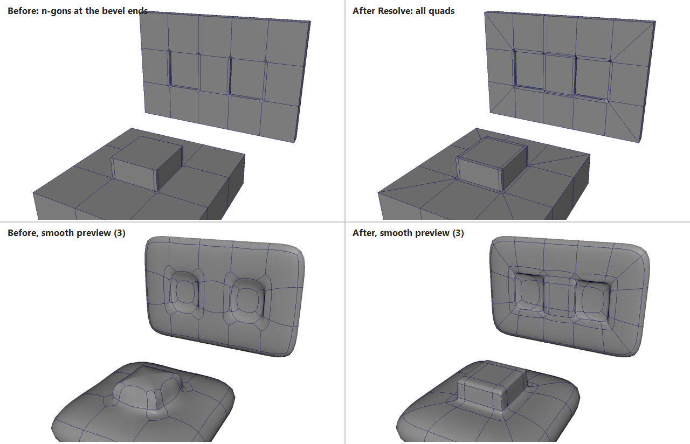

# Unlok Maya Toolbox

Fast, stable modeling helpers for Maya in one tabbed window. The whole toolbox
is a **single self-contained Python file**: paste it into the Script Editor and
run it. No install, no extra folders, no third-party packages, so it works in
locked-down / secure Maya setups.

Built for **Maya 2023** (Python 3.9, PySide2); also runs on 2024 and 2025.

## Run it

1. Open `UnlokToolbox.py`, select all, copy.
2. In Maya: **Windows > General Editors > Script Editor**, open a **Python** tab, paste.
3. Run it (Ctrl+Enter, or the run button).

Running it again just replaces the window. To make a shelf button, select the
pasted code in the Script Editor and middle-mouse-drag it onto a shelf.

## Tools

### Modeling > Path Scatter

Draw a path on any surface and lay objects along it: neat arrays,
roof shingles, fences, kerbs, or randomly scattered rocks. It's a light,
crash-free replacement for the MASH path workflow.

**Basic flow**

1. Pick a source: **Cube / Cylinder / Plane / Sphere** (sized in the tool), or
   select your own objects and press **Use Selected Meshes**. Picking several
   gives you random variants.
2. Press **Draw Path** and drag across a mesh. The stroke sticks to whatever
   you start drawing on. With nothing under the cursor it draws on the grid.
   - **Shift**: straight line (still follows the surface)
   - **Ctrl**: add another path to the same scatter
   - **Q**: finish drawing
   Or select an existing curve, or **polygon edges** (e.g. a roof eave), and
   press **Use Selection as Path**.
3. Tweak the settings. Everything updates live.
4. **Bake** as Instances, Copies or one Combined Mesh.

**Settings at a glance**

| Section | What it does |
| --- | --- |
| Source | Preset type and size (Length runs along the path), which axis of your mesh faces forward / up, and the pivot (Bottom = rests on the surface). |
| Distribution | *Fit to Size* packs items end to end using their real length plus *Gap*. Also *Spacing* or exact *Count*, and start/end trims. |
| Rows (grid) | Repeat the line side by side. *Stagger* 0.5 gives a brick/shingle offset, *Row lift* raises each row so they overlap, and negative *Row spacing* flips the side. |
| Orientation | Follow the path, align to the surface normal or world up, snap to the surface, plus rotation offsets (e.g. *Rotate Z* to tilt shingles). |
| Scale | Overall and per-axis scale (handy for your own meshes). |
| Randomness | Seed / Re-roll, scale range, per-axis jitter, random rotation, position jitter, skip %, random or cycled variants. |
| Drawing & Output | Stroke smoothing, a max-items safety cap, bounding-box preview for heavy meshes. |

**Recipes:** the *Recipe* dropdown at the top of Source sets everything up
for a common job in one click: Neat Array, Roof Shingles, Messy Thatch,
Rocks / Debris or Fence Posts. Then tweak from there.

**Shingles:** pick the *Roof Shingles* recipe and draw along the eave. If the
rows go downhill instead of up, flip the sign of *Row spacing*. Change *Seed*
or tweak the jitter until it looks hand-laid.

**Thatch / straw roof:** pick *Messy Thatch* and draw along each eave (Ctrl
adds the second side). Each strand is a thin cube whose *Width* is the strand
length, so strands run down the slope. Twelve overlapping rows with *Row lift*
build up the layers, while random tilt, fan (*Rotate Y +/-*), stretch, side
jitter and *Skip %* make it messy. Want it shaggier? Raise *Rotate X +/-*
and *Offset side +/-*. Thicker? Lower *Spacing*. A full roof of about 5,500
strands rebuilds in about 0.2 s, and rotation tweaks take about 0.06 s.

**Drawing tips:** a stroke follows whatever mesh is under the cursor, so you
can cross several pieces. If you have meshes selected when you press Draw
Path, strokes stick to those. Glancing off an edge (onto a wall under the
eave) is ignored automatically.

**Good to know**

- Select any part of a scatter in the viewport or Outliner and the panel
  loads it back, settings and all. Tick *Keep live system* when baking if
  you want to come back to it later.
- Editing your source mesh, moving curve CVs or changing the surface
  updates the scatter live.
- Your own meshes are used in their object space. Where they sit in the
  scene doesn't matter, and the tool never moves or changes them.
- Live tweaks don't fill your undo queue. **Bake cannot be undone with
  Ctrl+Z**: delete the baked group instead, or tick *Keep live system* first.
- **Bake modes for big counts:**
  - **Combined Mesh** is the fastest (about 0.4 s for 6,000 pieces). It
    keeps UVs, hard edges and per-face materials.
  - **Copies** is quick too.
  - **Instances** gets slow beyond a couple of thousand, because Maya itself
    slows down per instance. The tool warns you and offers the faster modes.
- Live scatters rebuild their preview when you open a scene with the toolbox
  open, or when you open the toolbox.

### Modeling > Bevel Resolver

Cleans up after hard-surface bevels for SubD. A bevel with **Chamfer off**
keeps edges sharp when smoothed, but wherever a bevelled edge chain *ends* it
leaves 5-, 6- and 7-sided faces: the chamfer corner spills an extra vertex
into every face around it. Bevel Resolver turns those into quads in one click.



1. Select one or more meshes (the whole mesh is checked), or some faces,
   edges or vertices (only the n-gons there are resolved).
2. Optional: **Select N-gons** shows what it will work on, changing nothing.
3. Press **Resolve**. One Ctrl+Z undoes everything.

**What it does**

- **Chamfers side by side merge:** when two chamfer tips land on the same
  face, they're joined straight across, so the bevels run into each other.
- **A lone chamfer gets one diagonal** from its corner up to a vertex on the
  next loop (two cuts meeting at one vertex where two chamfers share it).
  The pole that leaves sits on the flat area, not on the bevel.
- **Support loops carry across:** a face where loops end on opposite sides
  in matching numbers (the top of a boss with bevelled sides) gets the loops
  continued straight through, as a grid, with no poles.
- **Odd-sided faces are paired:** a 5- or 7-sided face can't become quads on
  its own. It's paired with the odd face next to it (the shared edge gets one
  new vertex), or a short edge loop runs between the two through flat quads.
  New vertices go on flat edges, never on a hard corner.

**Options:** *Faces* (bevel n-gons only, or every n-gon), *Strip ratio* (how
thin a quad must be to count as a bevel strip), *Max loop* (how far a pairing
loop may run) and *Loops may end on an open border*.

**Left alone and listed** (click a row to select them): faces with holes,
faces over 16 sides, zero-area faces (Maya's bevel makes these where two
recesses touch), odd faces with no partner nearby, and n-gons with no clean
split. The original vertices never move: it only adds edges and vertices.

**Speed:** about 0.3 s for a façade with 24 windows (200 n-gons), 1 s for 50
windows. A 200-window wall (1,600 n-gons) takes about 10 s with the bevel
still in its history, because every Maya poly command re-evaluates the
history. Delete history first to halve that.

### Modeling > Log Noise

Turns cylinders into natural-looking logs for shack supports, posts and
fences.

1. **Select** cylinders with some height and axis subdivisions (e.g.
   24 x 20). Selecting vertices instead, soft selection included, roughens
   just that part of a log.
2. **Apply to Selected:** each log gets its own random seed. One Ctrl+Z
   undoes it.
3. **Shape:** the sliders edit the selected logs live, like the Channel Box
   on several nodes.
   - Bumps, Bump size and Grain shape the surface; Grain stretches the bumps
     along the log like wood grain.
   - Bulge, Bend and Taper shape the log as a whole. The ends stay put when
     it bends.
   - Detail and Axis are under Advanced.
   - Randomize Seeds gives each log a new seed.
   - Everything is relative to the log's own radius and length, so it works
     at any scale.
4. **Finish:**
   - **Bake** keeps the shape and forgets the settings.
   - **Reset** puts the cylinder back.
   - **Select Logs With Noise** finds them all.

No plugin and no extra nodes: each mesh stores its original shape and
settings in hidden attributes, so scenes open anywhere and you can come back
and re-tweak later. About 0.13 s per update for a 3,900-vertex log.

### Modeling > Rope Lashing

Ties logs together with rope the way pioneering lashings are really tied,
for stilt shacks, fences and frames.

1. **Select** two logs that touch or cross. Select a whole frame instead and
   each joint gets its own lashing. Logs selected together are bound
   together: where several logs meet at one spot (a post, a beam on it and
   rafters resting there) one continuous rope binds them all, joint after
   joint, with one starting and one finishing hitch. Members are tied to
   the joint's main log (a post with two beams and a brace: each to the
   post), and to the log they rest on before tip-to-tip ties. A knee brace
   whose end butts against a post gets its own saddle there. For separate
   lashings, select two logs at a time. For logs side by side, also select a
   vertex or edge to say where along them the lashing goes. Select an
   existing lashing to edit it.
2. **Lashing and rope:** everything here shows straight away. With logs
   selected, a preview lashing appears on them (the banner says
   **PREVIEW**) and follows every click, so you can flip between lashing
   types and rope styles to compare. The preview stays on its logs when you
   deselect them, so you can look at it shaded and keep tweaking. With
   lashings selected, the same controls edit them live (the banner says
   **EDITING**).
   - **Preset:** picking one loads it. Built in: Standard, Hero
     (close-ups), Background (light), Thin twine and Heavy rope.
     **Save...** keeps your own in Maya's preferences (an optionVar, so no
     files), ready for any scene.
   - **Lashing** (one click each). *Auto* picks from the angle:
     - **Square** (crossing near 90 degrees): clove hitch on the upright,
       3 wraps in front of the crossbar and behind the upright, 2 frapping
       turns between the logs, clove hitch on the crossbar.
     - **Diagonal** (crossing at a slant, X braces): a hitch around both
       logs, 3 wraps on each diagonal, 2 fraps, clove hitch.
     - **Round** (side by side): clove hitch around both, 7 tight wraps,
       clove hitch.
     - **Sheer** (A-frames): wraps, then fraps between the legs, with a
       hitch on each leg (when the legs touch there's no room between them,
       so the hitches go around both and there are no fraps).
     - **Bands:** plain wraps, no knots (background).
     - **Tripod** (3+ logs side by side in a row, or splayed tripod legs):
       figure-of-eight racking turns woven over and under alternate logs,
       then frapping turns cinching every gap, clove hitches on the outer
       logs.
     - **Bundle** (3+ logs packed together, e.g. 2 x 2): tight turns round
       the whole bundle. Splayed legs (a standing tripod) are bound up where
       they meet.
     - **Saddle** (picked by itself when a log ends at the other: a post
       under a beam, a rafter resting on a beam): wraps go over the top log
       on each side and half round the end log just below its end, crossing
       in an X.
     - Clove hitches are snug two-turn hitches whose cut ends are tucked
       under the turns, so no loose ends stick out.
   - **Rope:** *3 strands* is real laid rope for close-ups; *Twisted* is one
     tube shaped like laid rope (the all-rounder); *Smooth tube* is the
     light background version.
   - **Thickness** is relative to the thinner log, so a preset suits any log
     size. Wraps, Fraps (Auto follows the recipes above), clove hitches on /
     off, Tails (the cut ends), Wobble (default 0.05: a tight rope; raise it
     for a hand-tied look), **Tension** (how hard the rope is pulled tight
     as it settles), **Gravity** (lets rope that isn't on a log sag) and
     Seed (Auto: each pair of logs
     keeps its own, so the preview and the result match).
   - Advanced: Bite (how far it presses into the wood), Sides, Segment
     length, **Settle** (simulation steps; 0 = off, fastest) and Lay (how
     tight the strands twist).
3. **Preview and lash:**
   - **Lash** keeps exactly what the preview shows (one Ctrl+Z). With logs
     selected it ties those (**Lash Selected**); with nothing selected it
     ties the previewed ones (**Lash Preview**). So either select logs, set
     things up and Lash, or preview, deselect, tweak, then Lash.
   - *Selecting logs previews them straight away* is on by default, but only
     while Rope Lashing is the tool on screen: opening the toolbox or using
     another tool never makes a preview, and switching away removes it.
     Turn it off for big frames, or to click around without moving the
     preview; **Preview Selected** then puts it on the selected logs.
   - **Clear Preview** removes it. The preview isn't undoable, can't be
     selected and is never saved with the scene. For big frames it shows
     the first 12 lashings (Lash still ties them all).
4. **Finish:** **Refit to Logs** re-ties lashings to logs you've moved (each
   keeps its own settings). **Bake** turns lashings into plain meshes: the
   selected ones, or with none selected every lashing in the scene plus the
   preview, all in one Ctrl+Z. **Select Lashings** finds the ones tied to
   the selected logs.

**With Smart UDIM:** lashings carry a "UVs ready" tag, so when Smart UDIM
scans an asset that contains them they're marked **Keep UVs**: Auto UV
never re-unwraps or scores them, and layout still packs them with
everything else. Marking one Auto yourself removes the tag, so it stays
Auto.

How it stays accurate:
- The rope is pressed onto each log's real surface (ray casts), so bent,
  tapered and Log Noise logs work.
- Every later pass of rope rides over the earlier rope it crosses, which is
  what makes the hitches and fraps read as knots.
- Each lashing then settles in a small rope simulation: tension pulls out
  slack, stiffness eases kinks, gravity sags free spans, friction keeps
  turns on the logs, and the rope can't pass through the logs or itself,
  so the crossings stay as tied. About 1 s per lashing.
- The rope behaves as if under tension: it bridges short dips between the
  ropes it crosses instead of sagging back onto the wood, and hitches pick
  up the rope's direction of travel, so it spirals in and out of them
  instead of jogging sideways. Bends tighter than the rope can take are
  eased.
- Rope never cuts through a log.

UVs are straight strips (U around the rope, V along it) cut into columns
that fill 0..1 at one texel density, with no overlaps. Ropes are named
`ropeNatural_C_lashing0001_GEP` and grouped under `lashings_GRP`.

**Speed:** a square lashing on 30 cm logs takes about 0.2 s as a smooth
tube, 0.5 s twisted and 0.8 s in 3 strands. A frame of 8 joints takes about
2 to 5 s.

### UV > Smart UDIM (in progress)

**Finding your way:** only the step you're on stays open (plus any step
that needs a look, marked amber). Finished steps fold to a one-line
summary. The strip of numbers under the NEXT banner jumps to any step:
green ticks are done, teal is now. Click any step's title to open or fold
it. Each step's settings sit under **Options**, and the UV-status legend
appears when you tick *Colour meshes by UV status*.

Organises an asset for UDIM layout by **section** (one band of UDIM rows,
e.g. west wing / east wing) and **material group**, at consistent texel
density. The actual layout is still being built; see
[docs/smart-udim-plan.md](docs/smart-udim-plan.md). Available now:

1. **Pick the root:** select the asset's top group (e.g. `house_GRP`) and
   press **Use Selected Group**.
   - **Your progress is saved with the scene.** Save the scene, reopen it
     later (or reopen the toolbox), and Smart UDIM picks up where you left
     off: the pre-process report, analysis and Auto UV results, the
     validation report and all your settings.
   - Groups, Keep UVs / Hands off marks and locks come straight from the
     scene's sets, as before.
   - **More than one setup in a scene:** the most recently used one opens;
     switch between them under **Setups**.
   - **Start Fresh** forgets the saved reports and results. It leaves
     groups, marks, locks and UVs alone.
2. **Scan:** sorts every mesh into sections and material groups.
   - **Section from Group** (step 3): select one or more groups in the
     Outliner and press it. Each becomes a section named after the group
     (`westWing_GRP` -> `westWing`; with one group you can change the name)
     holding every mesh inside, each in its own material group. The section
     stays linked to the group, so meshes you add there later go into it on
     the next Scan.
   - **Move to Section:** highlight a section, select meshes, faces or
     groups in the scene, press it.
   - **Delete Section:** its meshes go back to the section of the group
     they're in (or the first section).
   - **Move to Group / New Material Group** do the same for material groups
     inside a section. Every button accepts groups as well as meshes,
     right-clicking the list offers the same actions, and empty material
     groups are tidied away. Each action is one Ctrl+Z.
   - **Material groups:** come from the UnlokRenamer naming
     (`woodGreen_C_beam0001_GEP` goes into `woodGreen`). A variant letter
     after the colour makes its own group (`glassClearA`, `glassClearB`).
     Meshes whose names don't follow it fall back to their assigned Maya
     material, per face.
   - **Sections:** tick *New sections from top-level groups* to make each
     child group (e.g. `westWing_GRP`) its own section.
   - **Re-scanning:** only sorts new meshes; existing groups are kept.
3. **Edit:** use the tree, or the sets themselves.
   - **Groups are plain Maya sets:** `house_smartUDIM_SET` contains
     `westWing_UDS`, which contains `td100_woodGreen`. Rename a set to
     `td150_woodGreen` to give it 150% texel density, or add `_stack` to
     stack identical shells. You can make sets by hand too.
   - **In the tree:** double-click **TD %** to edit it, tick **Stack**,
     **Assign Selection** to move meshes or faces between groups, **New
     Group / New Section**, and **Move Up / Down** to set the section order.
4. **Naming issues:** lists meshes whose names break the convention, so you
   can fix them in UnlokRenamer and re-scan.
5. **Pre-process:**
   - **Fixes:** lamina faces, non-manifold geometry and zero-area faces.
   - **Warns:** about n-gons (they're left alone) and flipped UV faces.
   - **Lists for skipping:** meshes with missing UVs, faces without UVs, and
     instanced meshes.

6. **Auto UV**: for assets that are modelled, named and grouped but don't
   have good UVs yet. It gives you an organised, usable base to polish from;
   it doesn't aim for perfect UVs.
   - **Do It All** (top of the panel): one click to Auto UV everything that
     needs it, lay it all out and validate.
     - It respects your sections, groups, Keep UVs / Hands off marks, locks
       and every setting in steps 6 and 7.
     - It scans first if there are new, ungrouped meshes.
     - It asks once with a summary of what it'll do, then you can leave it
       running.
     - Esc stops it. Finished steps stay, each its own Ctrl+Z (layout, then
       Auto UV).
     - At the end it says how many meshes were unwrapped and laid out, how
       many need a look, and what validation found. From there you can
       re-lay out, add sections, or re-UV things as you go.
   - **UV status colours** (the strip at the top of the panel): tick
     *Colour meshes by UV status* to see where you are in the viewport.
     - **Yellow:** needs UVs.
     - **Red:** a problem, for example Auto UV failed, or the mesh is
       instanced.
     - **Greens:** Good UVs, Keep UVs (your marks) and Auto UV'd.
     - **Light blue:** laid out by Smart Layout.
     - **Blue:** Hands off.

     Meshes change colour live as Auto UV works through them. Each legend
     entry shows a count; click it to select those meshes (e.g. select every
     Good UVs mesh and mark it Keep UVs). The colours are temporary preview
     materials. Your real shading is stored on each mesh, Scan keeps reading
     it, and unticking puts it back exactly (per face too).
   - **Tracking sets:** Auto UV records what it unwrapped in
     `<asset>_uvAuto_SET` and what needs a human in `<asset>_uvProblem_SET`.
     Smart Layout records what it placed in `<asset>_uvLaidOut_SET`. They
     stay separate from your own Keep UVs / Hands off sets, so you can
     always tell your hand-laid work from Auto UV's.
   - **Why is it red? (the inspector):** click a mesh in the viewport, or a
     row in the list.
     - The box under the list shows its state, its UV score now, what Auto
       UV last did to it, and for red meshes why it's red and what to do.
       Its row is highlighted too.
     - **Fix** does the right thing for the reason:
       - re-unwraps it, forced even if an old Check UVs called it good;
       - or, when its UVs already score fine and the red flag is just out
         of date, clears the flag.
     - **Re-unwrap with Unfold3D** tries Maya's unwrapper instead.
     - **Select bad faces** selects the stretched, folded, overlapping or
       UV-less faces that pull the score down.
     - **Clear problem** accepts the UVs as they are.
     - **Show only problems** filters the list down to the red meshes.
     - The scores' reasons now say what's wrong and how much, e.g. "12%
       stretched (over 4x off its shell), 3% overlapping".
     - A mesh goes red when:
       - Auto UV failed on it;
       - its UVs score under *Keep above* after unwrapping;
       - or it's instanced: it shares its shape with another transform,
         so it can't get its own UVs. Make it unique, or mark it Hands off.
     - Marking a red mesh Keep UVs or Hands off takes the red flag off. It
       used to stay red, because the flag outranked your mark.
   - **Auto UV Selected:** only the selected meshes or groups, so you can
     work through an asset bit by bit. Each one is fitted into its own tile
     (see step 4 below); nothing else moves, and Hands off meshes are never
     touched.
   - **Speed on big assets:**
     - Meshes whose projection is already clean (every edge's UV length
       the same multiple of its 3D length: walls, planks, boxes) skip
       Unfold3D. On the test building that's 99 of 102 meshes.
     - Check UVs remembers its scores with the scene and only re-scores
       meshes that changed (47 meshes: 0.11 s, then 0.01 s).
     - At 3,000 meshes the panel refreshes about 10x faster. It only
       refreshes when the asset's sets or meshes actually change, so
       undoing unrelated work doesn't touch it.
     - Scan shows progress, and Esc rolls it back.
   - **Auto UV doesn't score.** It unwraps every mesh that isn't marked
     Keep UVs or Hands off.
     - **Check UVs** is optional. Run it when some meshes may already have
       decent UVs you forgot to mark: Auto UV then keeps the ones it found
       good (green), as long as you don't edit them afterwards.
     - Hands off meshes are never scored or traced shell by shell, however
       heavy. Colours, Plan, packing and Validate stay quick: a
       160,000-face Hands off mesh costs 0.01 to 0.2 s.
   - **Check UVs** (was Analyse) scores every mesh's UVs from 0 (none or garbage) to 1
     (clean) and lists them worst first. A face counts as bad if it has no
     UVs, is collapsed, folded or overlapping, or is stretched more than 4x
     compared with the rest of its own shell. Rectangulated or straightened
     shells and shells at different densities aren't penalised.
   - **Auto UV** works through these steps:
     1. backs up the current UVs into `map1_backup` (only if that set doesn't
        exist yet, so re-runs keep your originals)
     2. cleans bad geometry
     3. re-unwraps every mesh scoring below *Keep above* (0.85) with the
        chosen *Unwrapper* (below)
     4. fits each unwrapped mesh into one UDIM tile, as big as it fits
        and at one density for the mesh, without laying meshes out against
        each other. That's Smart Layout's job, later. Meshes sharing a tile
        overlap until then. The tile is:
        - the one the current layout plan puts the mesh in, if there's a
          plan;
        - else one its group was laid out in by Apply Layout (the one it's
          in now, if it's one of them);
        - else the tile its old UVs were in;
        - else 1001, for a mesh with no UVs yet.

        (Engine scripts can still pack each material group into its own
        tile with `run_auto_uv(pack=True)`.)
   - **Progress:** Maya's progress bar at the bottom of the window, and the
     Auto UV step itself, show each stage, the mesh or batch it's on, a
     percentage and the time left. Press **Esc** to stop at the next mesh;
     one Ctrl+Z then undoes what was done. A long pause only happens inside
     one Unfold3D call on a big mesh, and the bar names it first.
   - **Unwrapper: Unlok (fast)**, the default, is the toolbox's own
     unwrapper. It runs in the background, so Maya stays responsive and
     Cancel works at once.
     - **Repeats are unwrapped once.** Pieces with the same topology and
       edge lengths are recognised, whether they're duplicated and combined
       into one mesh or kept as separate meshes. One gets unwrapped; the
       rest copy its UVs (scaled if the copy is scaled). A combined grid of
       36 pegs costs about the same as one peg.
     - **Hard surface or organic:** each piece is sorted by its edges.
       - **Hard surface** (flat areas, hard or sharp edges) is cut along
         hard edges and edges sharper than *Seam angle*. When a mesh mixes
         hard and soft edges, its soft edges are trusted as "one surface":
         only hard edges (and anything sharper than 80 degrees) are cut, so
         a low-poly pipe's soft sides stay one tube even when it bends.
         Each part is then
         unfolded at its true size, and the parts are sewn back together
         wherever they lie flat without overlapping, like unfolding a box.
         A box or a plank comes out as one shell with no stretch.
       - **Organic** (smoothly curved everywhere) only cuts very sharp
         edges. A closed shape gets one pelt cut between its two farthest
         points, and the result is relaxed.
     - **Flattening:**
       - Flat parts are projected.
       - Developable ones (planks, boxes, cylinders, cones, tubes) are
         unfolded triangle by triangle, which is exact. A ring (a
         cylinder's side) gets one cut between its rims and unrolls with
         no stretch.
       - Curved parts are relaxed (as-rigid-as-possible). Bent, tapered,
         wobbly or triangulated tubes start from a rectangle (rim length by
         tube length), and closed shapes cut by a pelt start from an
         ellipse. The relax then only has to take out the bend, so such a
         tube comes out as one shell.
       - A part that would fold over or stretch badly is split and tried
         again.
     - **Join shells:**
       - *As few shells as possible* (default): sew everything that fits.
       - *Compact shells*: sew only while the shell stays compact, which
         packs tighter.
       - *Keep every cut*: leave a seam on every hard and sharp edge.
     - **Big curved parts** (over 6,000 triangles, e.g. a dense dome or
       rock) are relaxed coarse-to-fine, still without Unfold3D:
       1. a ~1,000-triangle version is relaxed fully
       2. the rest is filled in between it
       3. two full-detail passes finish it

       Unfold3D is never called. Anything still too stretched is split and
       relaxed again.
     - **Speed** on the 47-mesh test building, all in the background:
       - 46 meshes (walls, planks, posts, columns, rings, curved panels)
         take 0.04 s together.
       - The 19,200-face closed dome takes about 8 s: relaxing big smooth
         shapes in plain Python costs time.
       - The whole Auto UV run takes 9.6 s with Unlok vs 5.2 s with
         Unfold3D, at the same quality score. Unfold3D blocks Maya for its
         whole run, while Unlok keeps Maya usable and Cancel instant.
   - **Unwrapper: Unfold3D (Maya)** is the old route:
     - normal-based projection
     - soft edges sewn; hard edges and edges sharper than *Seam angle* cut
     - Unfold3D auto-seams for closed shapes, then relax
     - extra cuts where shells are still stretched

     A shell whose projection is already clean skips Unfold3D, and only
     curved shells are unfolded. A single Unfold3D call on a big mesh still
     blocks Maya until it's done.
   - **Restore Backup** copies the backup set back into `map1` for the
     selected meshes, or for all of them if nothing is selected.
   - **Meshes you've already UV'd:** select them and press one of these
     buttons (or double-click the **Status** column to cycle). The marks
     live in two sets under the asset's root set, `<asset>_uvKeep_SET` and
     `<asset>_uvHandsOff_SET`, so you can also check or edit them in the
     Outliner.
     - **Keep UVs:** UV'd but not laid out. They're never re-unwrapped, but
       still sorted into groups, scaled to texel density and packed with
       everything else.
     - **Hands off:** finished and already in their UDIM. Auto UV and the
       layout never touch them (no unwrap, no backup copy, no moving), and
       Auto UV's packing starts above their tiles. Validation still checks
       them for overlaps, tile crossings and padding, but not for density.
     - **Auto:** back to normal, where the score decides.
   - About 7 s for a 47-mesh test building that includes a 19,000-face dome.
     The whole run is one Ctrl+Z.

7. **Smart layout**: the even-density UDIM layout.
   - Set *Density px/m* and *Map size*, then press **Plan**. The UDIM Map
     previews every shell coloured by material: hover for density, coverage
     and tiles, click to select a group, and locked tiles show hatched.
     Changing a setting re-plans instantly. **Apply Layout** writes it.
   - **Plan runs in the background.** Once the shells are read, the search
     runs on its own thread: Maya stays usable, and changing a setting
     starts a fresh search (the old one stops). Apply and Do It All still
     plan on the spot.
   - **UV Viewer** (button next to Plan): a big window with the layout on
     the UDIM grid. While Plan searches it animates through the densities
     it tries. *Read Scene UVs* shows the UVs as they are in the scene now
     (each mesh is read once, then remembered until it changes).
     - Colour by material group, UV status (the panel's colours) or texel
       density (blue under target, green on it, red over).
     - Overlays you can toggle: section names down the side of their rows,
       UDIM numbers, and hatched reserved tiles.
     - Wheel zooms, middle-drag or Alt+drag pans, F frames. Hover a shell
       to see its mesh, group, section and density; click it to select the
       mesh.
   - **Labels in UV Editor** (checkbox): tile borders, UDIM numbers and
     section names inside Maya's own UV Editor. They're drawn by a helper
     mesh, `unlokUdimLabels`, which doesn't render and is added to the
     selection (the UV Editor only shows selected meshes). It updates with
     each plan. Untick it to delete the mesh; closing the toolbox deletes it
     too.
   - **Plan only lays out meshes that are ready:** Keep UVs, Auto UV'd,
     already laid out, or scoring well. Meshes that still need UVs, and
     meshes with junk UVs (thousands of shells, or most faces their own
     shell), are left out and listed. The banner then says to run Auto UV
     first.
   - **Every heavy step shows progress and stops on Esc:** Check UVs, Auto
     UV, Plan, Apply, Validate, Pre-process, Bevel Resolver and Log Noise.
     After half a second a **Working** window appears with what's
     happening and a **Cancel** button. Maya keeps redrawing, so Windows
     never marks it "Not responding", and Cancel or Esc stops within a
     moment (long loops check it as they go, not just between meshes).
     A cancelled Apply, Bevel Resolve or Log Noise apply rolls back
     completely, and never undoes your previous action. Validate and the
     hand-off sheet report junk-UV meshes instead of grinding through
     every shell.
   - **Mode: Fit sections to rows (the default).** It finds the highest
     texel density at which every section still fits on its own single row
     of UDIMs (the biggest section decides), and gives every shell that one
     density. Groups or sections set to + / - TD % keep their offset, and
     Hands off pieces stay as they are. The summary says which section is
     widest and how many tiles it uses. *Fixed density* (your own px/m) and
     *Fit to tiles* (a tile budget) are still there.
   - **Density:** every shell is scaled to exactly the target texel density,
     times its group's and section's TD %. A group renamed `td150_...` gets
     1.5x.
   - **Orientation:**
     - *Main axis*: the longest direction along U, lying flat. Packs
       tightest.
     - *Upright*: world up along +V, so brick courses stay level and walls
       read upright. Flat pieces fall back to Main axis.
     - *Keep*: never rotate, for shells you've already straightened.

     Override it per group with the **Orient** column (double-click to
     cycle), or put `_up` / `_keep` / `_axis` in the set name.
   - **Packing:** a 2D packer places the biggest pieces first, each in the
     lowest free spot. Small pieces fill the gaps left under bigger ones, and
     in Main axis mode a piece may turn 90 degrees if that sits lower. On the
     test building this fills about 83% of each tile, up from 65% with the
     old row packer, and needs 7 tiles instead of 9.
     - A group stays in neighbouring tiles: it may top up the tiles the
       previous group ended on, then opens new ones.
     - No shell crosses a tile border, and each section starts on a new row.
     - The same scene always gives the same layout.
   - **Stacking:** in a group marked `_stack` (Stack column), identical
     pieces such as repeated windows or tiles share one spot, so they cost
     one footprint, not N. Validation knows these overlaps are intentional.
   - **Hands-off tiles:** what happens to the tiles your Hands off meshes
     sit in. Either way they stay exactly where they are, show hatched in
     the map, and their tiles are never handed out as fresh tiles.
     - *Pack around them* (default): other pieces fill the free space
       around them, keeping the padding. Their own group gets first go.
     - *Reserve their tiles:* nothing else goes in those tiles. The plan
       warns when a hands-off piece fills under half its tile.
   - **Fit to tiles:** finds the highest density that fits your tile budget.
   - **Auto-compensate:** lowers only a group whose piece is bigger than a
     tile, and tells you so.
   - **Locks (Lock column):** a locked group keeps its UVs and its tiles stay
     reserved, so you can re-lay everything else around finished work.
     Groups whose geometry changed since they were laid out get flagged.
     *Spare room %* leaves slack around every shell so small changes still
     fit.
   - **Coverage:** written into the set names (`c222` = 2.22 tiles).

8. **Check & hand off**:
   - **Validate** checks the finished layout. Click any finding to select
     its faces.
     - Problems: UVs outside the UDIM range, shells crossing tile borders,
       overlapping shells (intentional `_stack` groups excepted).
     - Warnings: flipped shells, shells under 2 px, density more than 10%
       off the layout's target (locked groups excepted), shells closer
       together than the padding.
   - **Save Sheet PNG** / **Copy Sheet** gives texture artists a picture of
     the whole layout:
     - every shell filled and outlined in its material's colour (the same
       colour in every section)
     - tile numbers and section names per row
     - a title line with the asset, density, map size and date
     - a legend with each group's section, tiles, TD % and coverage

     Copy Sheet is there for locked-down machines where saving files isn't
     allowed. Sheet size is Small, Medium or Large (256, 512 or 1024 px per
     tile).

Every Smart UDIM action is a single Ctrl+Z.

## How it stays fast

- **Preview:** the live preview is a single `instancer` node whose point data
  is written directly from Python. There is no MASH network and there are no
  per-item nodes.
- **Surface snapping:** uses Maya's accelerated mesh intersector, about 60x
  faster than the plain closest-point query.
- **Caching:** placement (path sampling and snapping) is cached, so rotation
  and scale tweaks don't redo it.
- **Bakes:** Combined Mesh is built in a single API call instead of
  `polyUnite`.

Measured on Maya 2024 (`tests/bench_scatter.py`):

| Case | Before | Now |
| --- | --- | --- |
| Thatch roof, ~5,900 strands, rebuild | 2.7 s | ~0.2 s |
| Same, after changing a rotation | 2.7 s | ~0.06 s |
| 20,000-item array, rebuild | 0.43 s | ~0.2-0.3 s |
| Bake 5,900 pieces to Combined Mesh | 17 s | ~0.4 s |

## Development

- `UnlokToolbox.py`: the whole toolbox (the file you paste).
- `tests/test_toolbox.py`: headless engine and bake tests:
  ```bash
  "C:/Program Files/Autodesk/Maya2024/bin/mayapy.exe" tests/test_toolbox.py
  ```
- `tests/test_auto_uv.py`: headless Auto UV tests on a messy generated
  building (`--snapshot DIR` also writes a UV snapshot).
- `tests/test_smart_layout.py`: headless smart layout tests (exact density,
  tile borders, fit-to-tiles, locks, change detection, undo).
- `tests/test_validation_handoff.py`: headless validation + hand-off sheet
  tests (breaks shells on purpose and checks each problem is found;
  `--sheet PATH` saves the rendered sheet).
- `tests/test_speedups.py`: clean projections skip Unfold3D (same
  quality), remembered scores and their invalidation, Scan progress and
  Esc.
- `tests/test_fast_reads.py`: the API readers (`expand_members`,
  `meshes()`) match the old cmds versions, and refresh reads are fast at
  3,000 meshes.
- `tests/test_guards.py`: junk UVs flagged fast, Plan leaves unready
  meshes out, Esc stops every heavy step, cancelled steps roll back without
  touching the previous undo step.
- `tests/test_uv_states.py`: UV states, status colours (and the real
  shading coming back), tracking sets, Auto UV Selected.
- `tests/test_sections.py`: section from group, move to section, delete
  section, split faces, later Scans, undo.
- `tests/test_session.py`: Smart UDIM's saved progress survives a scene
  save and reopen, validation round-trips, deleted meshes drop out, and
  saving adds no undo step.
- `tests/test_auto_uv_progress.py`: Auto UV progress on a 141-mesh
  building (every stage reports, no unexplained silences, Esc cancels
  cleanly, one Ctrl+Z after a cancel).
- `tests/test_uv_status.py`: Keep UVs / Hands off marks through Auto UV,
  both hands-off tile modes and validation.
- `tests/test_layout_extras.py`: orientation modes, `_stack` stacking and
  2D packing (fill, padding, stable re-plans, speed).
- `tests/test_unlok_unwrap.py`: the Unlok unwrapper. Covers a box and a
  plank (one shell, no stretch), a cylinder, a sphere pelt, a torus, a
  combined grid of copies, cancel, undo, and Unlok vs Unfold3D on the test
  building. `tests/bench_unwrap.py [--profile]` times it per mesh.
- `tests/test_live_view.py`: shell outlines match their placements, the
  live-view hook, the background planner (same result, stops promptly),
  scene outlines and their density, the UV Editor label mesh.
- `tests/test_smart_udim.py`: headless Smart UDIM tests (naming, sets, scan,
  assignment, pre-process, undo):
  ```bash
  "C:/Program Files/Autodesk/Maya2024/bin/mayapy.exe" tests/test_smart_udim.py
  ```
- `tests/test_bevel_resolver.py`: headless Bevel Resolver tests (walls with
  window recesses, a boss, single edges, side-by-side chamfers, selection,
  reports, undo, speed):
  ```bash
  "C:/Program Files/Autodesk/Maya2024/bin/mayapy.exe" tests/test_bevel_resolver.py
  ```
- `tests/test_log_noise.py`: headless Log Noise tests. It checks shapes
  against the original deformer (`contrib/log_noise`), plus undo, live edits,
  masks, reset, bake, save/reopen and speed.
- `tests/test_rope_lashing.py`: headless Rope Lashing tests. Every lashing
  and rope style is checked for clearance from itself and the logs, UVs in
  0..1 without overlaps, undo / redo (with the re-tie), save / reopen, live
  edits, refit, a whole frame, Log Noise logs, presets and speed.
- `tests/gui_rope_lashing.py`: drives the Rope Lashing panel in a real Maya
  session and saves close-ups to `tests/_out/rope_lashing`. Launch it like
  the smoke test below, with `tests/run_gui_rope_lashing.mel`.
- `tests/gui_bevel_resolver.py`: drives the Bevel Resolver panel in a real
  Maya session and saves before / after screenshots (wireframe and smooth
  preview) to `tests/_out/bevel_resolver`. Launch it like the smoke test
  below, with `tests/run_gui_bevel_resolver.mel`.
- `tests/gui_smoke.py`: runs inside a real Maya session (opens the window,
  draws strokes through the viewport, saves screenshots to `tests/_out`).
  Set `UNLOK_TEST_DIR` to the `tests` folder (and `UNLOK_TEST_QUIT=1` to close
  Maya afterwards), then launch `maya.exe -script tests/run_gui_smoke.mel`.
- `tests/bench_scatter.py`: Path Scatter rebuild and bake timings
  (`--profile` prints the hot functions, `--quick` skips the slow
  Instances bake).
- `tests/gui_draw_bench.py`: measures how responsive path drawing is (time
  per mouse move in a busy scene). Launch it the same way with
  `tests/run_gui_draw_bench.mel`.
