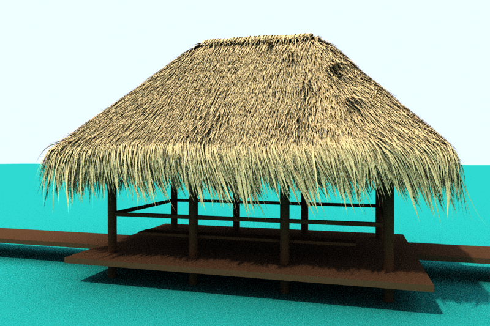

# Unlok Maya Toolbox: artist guide

A quick guide for artists picking up Unlok scenes. The full reference for every
setting is in the [README](../../README.md); this guide covers getting set up and
the tools you'll use most.

## Pages

- [Getting started](Getting-Started.md): install, open the window, scale, the shelf button
- [Roof](Roof.md): thatch / palm roofs from a box, presets, the settings that matter
- [Scatter](Scatter.md): moss, grass, leaves, debris and ivy on any geometry
- [Other tools](Other-Tools.md): Path Scatter, Bevel Resolver, Log Noise, Rope Lashing, Quad Fill, Smart UDIM, Renamer, Reframe
- [Tips and troubleshooting](Tips.md)

## The one-minute version

1. Get `UnlokToolbox.py` from this repo.
2. In Maya, open **Windows > General Editors > Script Editor** and a **Python** tab.
3. Paste the whole file and run it with Ctrl+Enter. The **Unlok Toolbox** window opens.
4. Pick a tab (Modeling, UV, Naming, Camera), then a tool.

The toolbox needs Maya 2023 or newer (also runs on 2024 and 2025). It has no installer and no extra files or plug-ins, so it works on locked-down machines.

**Scenes are in decimetres.** Unlok scenes are set to "cm" in Maya, but the toolbox reads them as 1 unit = 10 cm. Don't change the scene unit.
