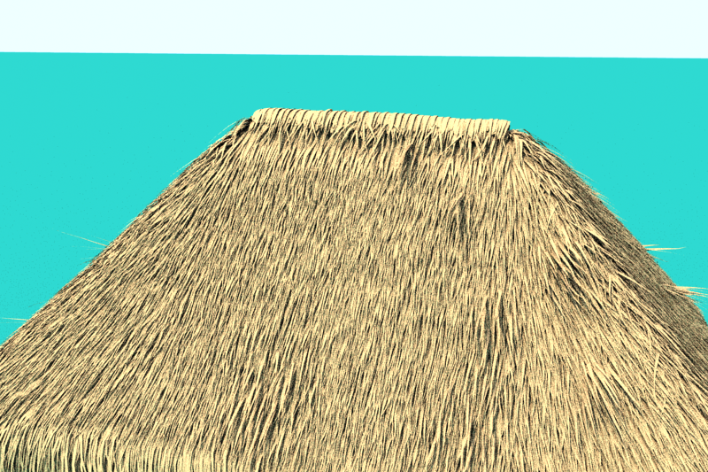

# Roof (Modeling > Roof)

[Back to Quickstart](Home.md) | Full reference: [README, Roof](../../README.md#modeling--roof)

Builds a whole roof from a simple box: palm thatch, straw thatch, corrugated
metal or clay tiles. You shape the box; the tool covers it.

## In a scene you've been handed

- Each roof has a **roof box**: a wireframe box around it that never renders. Select the box, or the roof, and the Roof panel shows that roof's settings.
- **Move, scale or reshape the box** (vertices too) and the roof rebuilds to fit, as long as *The roof follows its box* is on.
- Lost the box? **Make Box Again** (under *Copies and links*) makes a new one for the selected roof.

## Making a new roof

1. Press **Create Box**. With the building selected, the box sits on top of it. Fit it to the roof: footprint = the wall tops, bottom = the eave line, top = the ridge.
2. Pick a **preset**, e.g. `beach_dock_hut_001` (palm palapa, hipped, dried fronds).
3. Press **Make Roof**.
4. Work rough to fine with **Detail**:
   - **Proxy**: just the shell, instant.
   - **Rough** and **Medium**: for working.
   - **High** and **Hero**: only for final renders. If a build would go over the vertex limit, the tool eases the detail itself and says "Detail eased" in the status bar.

## Presets

- A **look preset** (palm, straw, etc.) sets every look setting. Anything it doesn't name goes back to default, so leftover tweaks from earlier don't carry over. Your Detail, seed and UV settings stay as they are.
- **Reset** (next to Save and Delete) puts every setting back to default. Try this first if a preset doesn't look like its pictures.
- **Save** stores the current settings as your own preset.

## Settings artists use most

| Want | Use |
| --- | --- |
| Longer or shorter eave fringe | **Fringe length**, **Edge droop** |
| Wind-swept fringe | **Wind** (-1 to 1) |
| Packed down, less fluffy | **Max angle** (lower = flatter), **Neatness** |
| Messier overall | **Messiness** |
| Ridge sits too low or looks sunken | **Ridge lift** (1.0 works for shallow roofs) |
| Fuller ridge | **Ridge layers** (1 to 4) |
| Tufts and flyaways | **Odd ones poking out**, then **... lift**, **... in clumps**, **... variation** |

Tip: for tufts, try Odd ones poking out 20 to 30, lift 1.3, clumps 0.5 and variation 1.0. This gives lone flyaways, tiny and small tufts, and one wide, low tuft.
