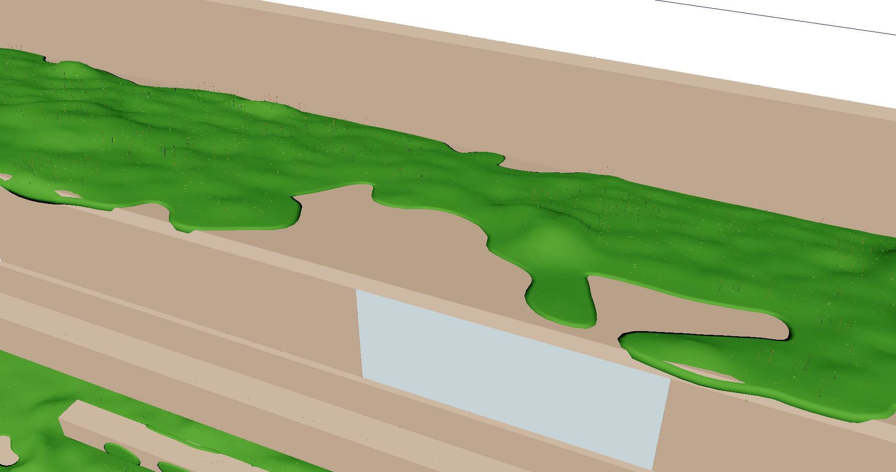
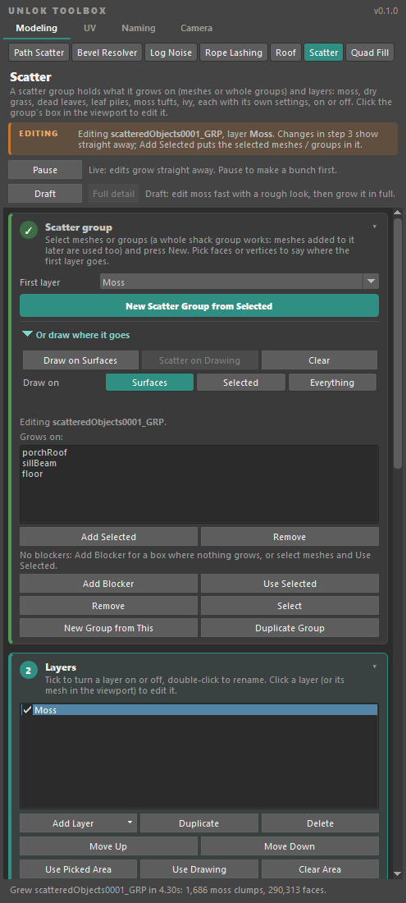
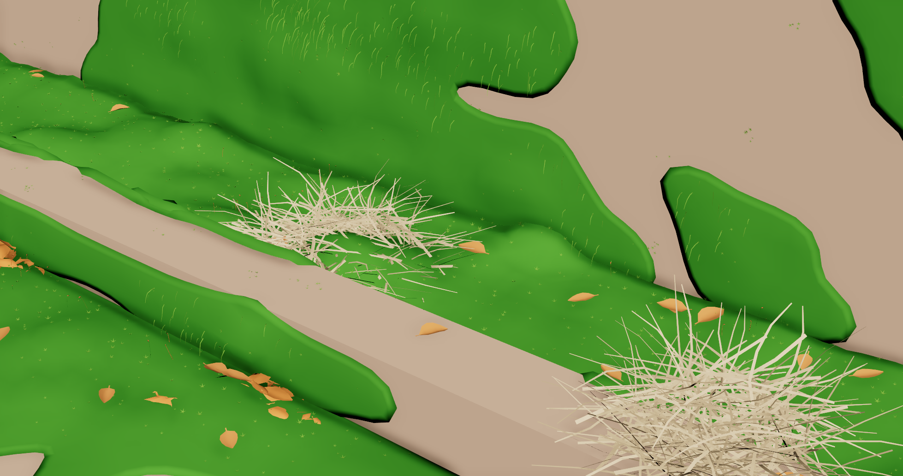
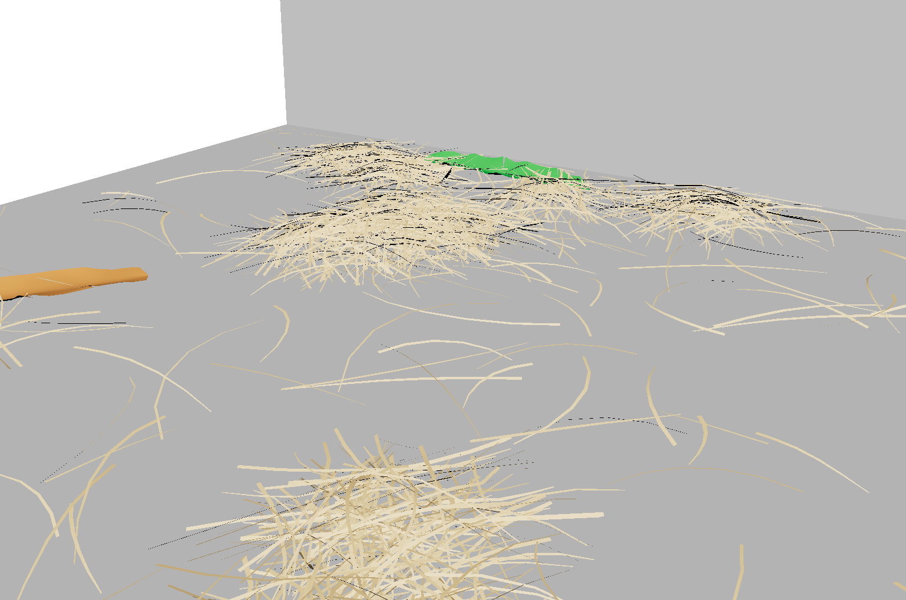

# Scatter (Modeling > Scatter)

[Back to Home](Home.md) | Full reference: [README, Scatter](../../README.md#modeling--scatter)

Grows moss, dry grass, dead leaves, leaf piles, moss tufts, dirt specks and ivy
on any geometry. A **scatter group** holds the meshes it grows on plus a stack
of **layers**, each with its own settings.

## Basic flow

1. Select the meshes (or a whole group) to grow on.
2. Choose the **First layer** type and press **New Scatter Group from Selected**.
3. Edit the layer in the panel. Changes show straight away.
4. Add more layers with **Add Layer**. Its menu has light quick picks, e.g. *Grass: scattered blades* and *Moss: light*, plus **Add Above** / **Add Below** to place a layer at a spot in the stack, and **Duplicate**.

## Work light, then add detail

- Every new layer starts as a **light** version that builds fast.
- Use **Draft** while you're blocking things in, then **Full detail** for the final look.
- Pick a fuller preset in the layer's preset list when you need more detail.
- Full moss is the heaviest layer. Use the light moss pick until you're happy with where it grows.

## Controlling where it grows

| Want | Use |
| --- | --- |
| Keep it off part of the mesh (e.g. wall tops) | **Add Blocker**: nothing grows inside the box |
| Only on flat or up-facing areas | **Slope limit** (0 = flat only) |
| Gather by walls, in corners, along edges, or out in the open | **Where it gathers** targets |
| Moss along a wall's top, edging down | **Height fade: From top**, **Fade by: Metres**, **Fade height** (how far down), **Runs** (streaky drips) |
| Up from the foot of a column or wall | **Height fade: From base** (or **Both ends**) |
| Patches instead of an even coat | **Patchiness**, **Patch size**, **Ragged outline** |
| Jagged moss edges, carpet breaking into cushions | **Outline detail**, **Breakup** |
| Exactly where you want it | **Draw on Surfaces**, then **Use Drawing**, or pick faces and **Use Picked Area** |

